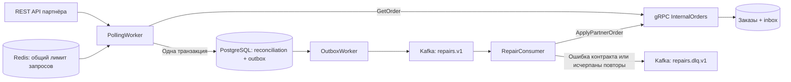

# Как устроена сверка

PartnerSync синхронизирует проекцию заказов, которой владеет партнёр. Сверяет статус, сумму в минимальных денежных единицах, валюту и версию источника. Внутренние платежи, складские операции и другие поля не входят в контракт исправления.

## Правила синхронизации

Каждый проход полностью обходит заказы партнёра через cursor pagination. Полная сверка обнаруживает также изменения во внутренней системе, даже если заказ партнёра давно не менялся. Проходы одного партнёра сериализуются session advisory lock в PostgreSQL. Разные партнёры обрабатываются параллельно.

Сервис фиксирует одно из трёх состояний:

| Состояние | Условие | Действие |
| --- | --- | --- |
| `consistent` | Совпадают поля и версия источника | Сохранить время сверки |
| `pending` | Заказ отсутствует или поля различаются; версия партнёра не ниже внутренней | Записать команду исправления в outbox |
| `conflict` | Внутренняя система уже содержит более высокую версию источника | Сохранить расхождение без автоматического отката |

`pending` означает результат последней сверки. После успешного исправления состояние сменится на `consistent` в следующем проходе. Это не журнал выполнения Kafka-команды. Неудачные проходы пишутся в лог; `checkedAt` позволяет увидеть устаревшие результаты.

Версия партнёра монотонно растёт при каждом изменении заказа. Внутренняя `revision` растёт при каждом изменении проекции. Сервис передаёт прочитанную `revision` как `expected_revision`. При конкурентном изменении принимающая сторона возвращает `Conflict`. Следующий проход перечитывает запись и принимает новое решение.

Удаление заказа не выводится из его отсутствия в выдаче. Отмена передаётся статусом `cancelled`. Обнаружение лишних внутренних заказов в этот сценарий не входит.

## Доставка и повторная обработка

Результат сверки и outbox записываются в одной PostgreSQL-транзакции. Ключ дедупликации — SHA-256 от партнёра, содержимого заказа и ожидаемой внутренней ревизии. Повторный проход с теми же данными не создаёт новую команду.

`OutboxWorker` берёт одну готовую строку через `FOR UPDATE SKIP LOCKED`, отправляет её в Kafka и ждёт подтверждения. Только после подтверждения отмечает строку опубликованной. Ошибки Kafka оставляют строку в outbox с экспоненциальной задержкой до 60 секунд. Число попыток публикации не ограничено.

Между подтверждением Kafka и commit PostgreSQL процесс может завершиться. Событие тогда публикуется повторно. Гарантия доставки — **at least once**. `EnableIdempotence` уменьшает дубли при повторах Kafka producer в рамках сессии, но не устраняет повторную публикацию outbox после перезапуска.

Принимающая gRPC-система записывает заказ и inbox в одной транзакции. Inbox хранит `event_id`, хеш запроса и результат. Повторный запрос возвращает сохранённый результат; повторное использование ID с другим содержимым отклоняется. Transaction advisory locks сериализуют обработку одинаковых ID и изменения одного заказа, включая создание отсутствующей записи.

Все сообщения заказа имеют Kafka key `partnerId:orderId`. Несколько издателей outbox могут отправить события в другом порядке, поэтому корректность дополнительно защищают `source_version` и `expected_revision`.

Consumer подтверждает offset после ответа gRPC или подтверждённой публикации в DLQ. Если исправление уже закоммичено, но ответ потерян, consumer повторяет тот же `event_id`. Если публикация в DLQ не удалась, worker останавливает host, оставляя offset неподтверждённым.

Некорректный JSON, неизвестная версия схемы и постоянные ошибки gRPC попадают в DLQ сразу. `Unavailable`, `DeadlineExceeded`, `ResourceExhausted` и `Aborted` повторяются до `MaxApplyAttempts`, затем также попадают в DLQ. `Conflict` и `Stale` считаются обработанными результатами. Статус уточнит следующий проход.

## Ограничение запросов

Redis хранит общий счётчик запросов каждого партнёра за секунду. Проверка лимита и увеличение счётчика выполняются одним Lua-скриптом. Время берётся у Redis, ключ живёт две секунды. Повторные HTTP-запросы тоже проходят через лимитер.

При недоступности Redis опрос приостанавливается с ошибкой прохода. Уже сохранённый outbox и обработка Kafka от Redis не зависят. Fixed window допускает всплеск на границе секунд; партнёрам со скользящим лимитом нужен другой алгоритм.

HTTP GET повторяется при сетевых ошибках, таймаутах, `429` и `5xx`. Максимум четыре попытки. Для `429` и `5xx` учитывается `Retry-After` с ограничением 30 секунд. Размер ответа ограничен 1 МиБ. Автоматические redirect отключены, чтобы ключ партнёра не ушёл другому хосту. gRPC-вызовы имеют deadline и поддерживают отмену.

## Границы демоверсии

- Один Kafka broker и одна PostgreSQL-инсталляция. Три логические схемы разделяют данные сервиса, внутренней системы и партнёра, но используют одну учётную запись для локального запуска.
- Bootstrap SQL применяется PostgreSQL только при создании пустого volume. Автоматических миграций существующей БД нет.
- HTTP и gRPC работают без TLS в локальной сети Docker. Ключи в конфигурации предназначены для демо. Для внешнего окружения нужны TLS, отдельные права БД, управление секретами и настройка аутентификации Kafka.
- Полный обход и отдельный gRPC-запрос на заказ рассчитаны на небольшой каталог. Для больших объёмов нужны batch RPC, ограниченный параллелизм и сочетание incremental polling с периодической полной сверкой.
- Cursor API не даёт общего snapshot. Изменения во время обхода обнаруживаются последующим проходом. Проверка не доказывает глобальную консистентность на один момент времени.
- После DLQ одинаковое расхождение не создаёт новую команду автоматически. Повторный запуск выполняется через API replay после устранения причины.
- Inbox и опубликованный outbox сохраняются без очистки. Удаление inbox сокращает окно дедупликации, а удаление outbox также удаляет ключи дедупликации. Политика хранения требует отдельного решения.
- Метрики `System.Diagnostics.Metrics` и `ActivitySource` доступны для подключения наблюдателей. OTLP exporter, Prometheus и распределённая передача trace context не настроены.
- Сборка, тесты и запуск в рамках создания проекта не выполнялись.
